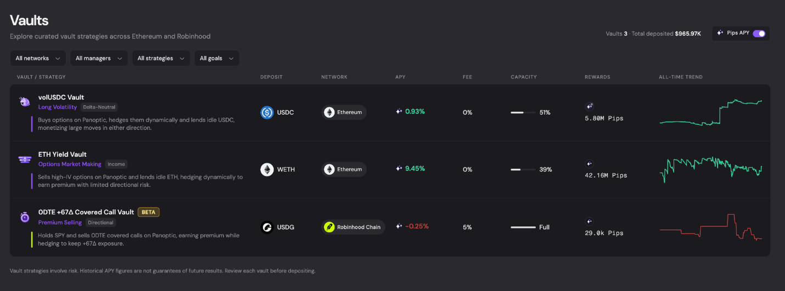
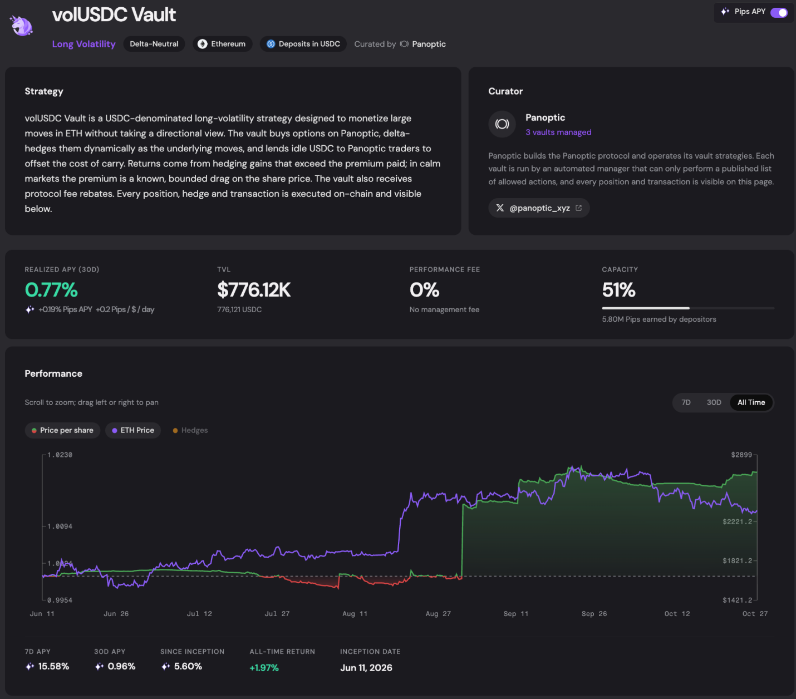

---

slug: panoptic-new-vault-UI

title: "Three Vaults, Three Ways to Put Your Assets to Work."

tags: [Vaults, Delta-Neutral, Income, Directionality]

image: /img/banners/vault-UI-banner.png

description: "Deposit caps have been lifted and new UI features have been implemented within the Panoptic Vault Suite. Read what has been changed in the UI/UX and dive into the investment mission behind each vault."

---

Running Panoptic’s vaults has reinforced a simple lesson: different strategies suit varying expectations.

A strategy that pays to capture ETH volatility behaves differently from one that earns income by selling it. A vault that hedges ETH price exposure serves a different purpose from one that deliberately maintains exposure to SPY.

Alongside the updated positioning, we’ve refreshed the vault interfaces and lifted deposit caps. Every vault’s positions and transactions are visible on-chain, so users can follow how the strategy operates. Deposits are now open. [Explore the vaults](https://app.panoptic.xyz/vaults) to get started!

# A Clearer Vault Experience

The updated lineup makes each strategy’s exposure and return sources easier to understand:

-   volUSDC: Buy volatility while dynamically hedging ETH price exposure.

-   ETH Yield: Earn income from selling options after depositing ETH.

-   0DTE +67∆ Covered Call: Maintain partial bullish SPY exposure while collecting same-day call premiums. Currently in beta.

# Delta-Neutral | volUSDC Vault

For USDC holders seeking returns from large ETH moves without choosing a direction.

[volUSDC](https://app.panoptic.xyz/vaults/ethereum/0x236d0558f06cd60780b232d4ec4c92d2cb7e4d18?backTo=%2Fvaults\&backLabel=Vaults\&selectedChain=ethereum) buys options on Panoptic and dynamically hedges its ETH exposure as the price moves. The strategy seeks to capture gains from those adjustments that exceed the options premiums paid. Idle USDC is lent to Panoptic traders to help offset the cost of maintaining the positions.

The vault targets neutral exposure to ETH’s price direction while retaining exposure to its volatility. It can benefit from a sufficiently large rally or selloff.

# Income | ETH Yield Vault

For ETH holders who want to earn additional ETH while maintaining exposure to the asset.

The [ETH Yield](https://app.panoptic.xyz/vaults/ethereum/0xd4e2c720a760049cc4151bcf61e3a9348db9cd92?backTo=%2Fvaults\&backLabel=Vaults\&selectedChain=ethereum) Vault sells high implied volatility (IV) options on Panoptic, earns Uniswap fees, and lends idle ETH to traders. It dynamically hedges to keep its exposure close to 100% ETH.

Its return sources are options premiums, swap fees, lending income, and protocol fee rebates. The strategy is strongest when ETH trades within a range and the income collected exceeds the costs of managing its positions.

# Directionality | 0DTE +67∆ Covered Call Vault

For users seeking bullish SPY exposure with an options-income component.

This USDG-denominated vault on Robinhood Chain buys SPY, sells zero-days-to-expiration (0dte) call options on Panoptic, and adjusts its SPY holdings to target [+67 delta](https://app.panoptic.xyz/vaults/robinhood/0x08b24123252bd9c4dd473b6573d4cf67196ffc4b?backTo=%2Fvaults\&backLabel=Vaults\&selectedChain=ethereum)—approximately two-thirds directional exposure.

Premiums contribute to returns alongside SPY price appreciation. The intended environment is a stable or gradually rising market, where the vault can collect premium while maintaining bullish exposure.

The strategy remains in beta. Its performance should be evaluated against its intended exposure and trading costs as the track record develops.

Explore the strategies, review their performance, earn pips, and deposit at [app.panoptic.xyz/vaults](https://app.panoptic.xyz/vaults).

*Join the growing community of Panoptimists and be the first to hear our latest updates by following us on our \[social media platforms](https://links.panoptic.xyz/all). To learn more about Panoptic and all things DeFi options, check out our \[docs](/docs/intro) and head to our \[website](https://panoptic.xyz/).*

