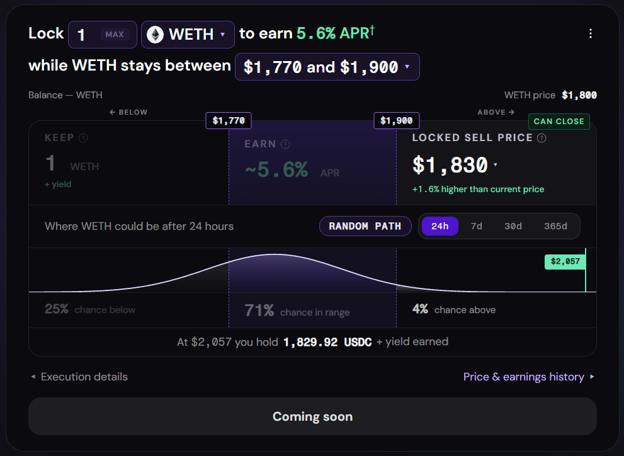
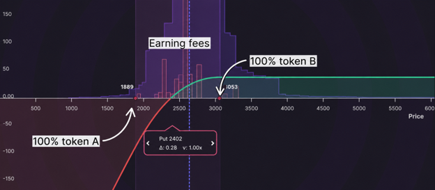
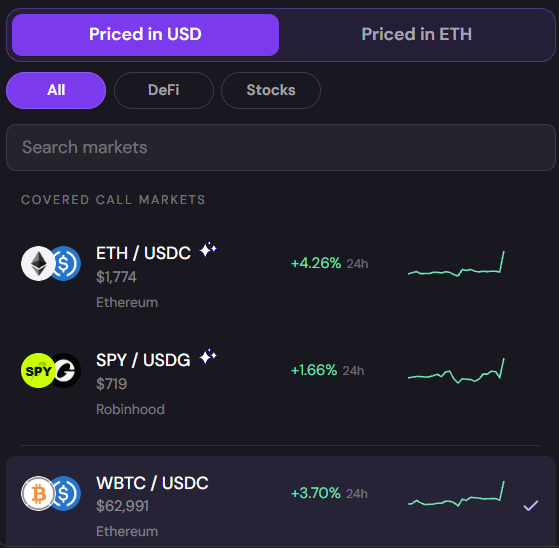

---

slug: panoptic-new-pccs

title: "Introducing Perpetual Covered Calls on Panoptic

tags: [Covered Calls, Income, Directionality]

image: /img/banners/pccs-banner.png

description: "Panoptic is permitting DeFi users to generate income on all of their favorite tokens through the launch of a novel Perpetual Covered Call (PCC) product."
---

_**Panoptic is unveiling Perpetual Covered Calls (PCCs) for blue-chip DeFi tokens and tokenized equities across Ethereum Mainnet and Robinhood Chain.**_

---

Covered calls have always had a compelling proposition: hold an asset you believe in, choose a price at which you’d be willing to sell it, and earn income along the way. It’s one of the most established strategies in traditional options markets. Yet bringing that same experience onchain has been surprisingly complicated, with traders often having to navigate complex interfaces or delegate their decisions to automated vaults.

  

With the introduction of **Perpetual Covered Calls (PCCs)**, Panoptic is opening up a new way to trade this familiar strategy. Built on Uniswap liquidity, new, self-directed PCCs put the entire experience in the hands of token holders. Choose your market, set your own selling range, explore potential earnings, and build a position around your view of the market. All through perpetual options with streaming premiums, without the constraints of fixed expirations or scheduled auctions.

  

DeFi has experimented with covered calls before, most notably through DeFi Options Vaults (DOVs), pioneered by Ribbon Finance. At their [peak](https://defillama.com/protocols/options-vault) in 2022, DOVs attracted over $497 million in deposits, demonstrating the appetite for options-based income onchain. But the model had its limitations. Manager-selected strikes, weekly auctions, and synchronized expirations left users with little say over how their positions were structured, while predictable selling [windows](https://medium.com/@orbitmarkets/dov-auctions-and-the-friday-problem-b979c30c8bc7) often compressed premiums.

  

Panoptic takes the lessons of that era and pushes the possibilities of onchain options further. Perpetual options and Uniswap’s concentrated liquidity infrastructure create an entirely new foundation for how covered calls can be constructed, traded, and eventually automated. With PCCs, that evolution starts with the individual trader, bringing greater control, flexibility, and a new dimension to earning income on assets they already own.

# Your Tokens. Your Range. Your Timing.

PCCs center the decisions that matter: which asset to use, where to set the selling range, and when to actively manage the position. The potential outcomes are intuitive:

-   Below the range: You retain both your underlying token and your previously accrued yield.
    
-   Within the range: Your position progressively swaps into the quote asset and collects streamia.
    
-   Above the range: Your position fully converts into ETH or USDC/USDT/USDG denomination unless the price re-enters the range. You can sell your token at a higher price to capture upside.
    

Unlike an automatic weekly roll, a PCC stays open until managed or closed. This differentiator is fairly significant when volatility shifts or major catalysts approach: users, not a vault’s calendar, decide whether the range still fits their view.

# A Covered Call, Built From Uniswap Liquidity

A Uniswap concentrated liquidity position placed above the current price begins in the underlying token and progressively converts it into the paired asset if the price rises through the range. Along the way, the position can earn swap fees. These combined elements of income, retained downside exposure, and a ceiling on upside beyond the range are structurally akin to a covered call.

Options traders will recognize this payoff: holding an asset and selling a call is equivalent to a cash-secured short put, and concentrated liquidity is a perpetual version of that exposure. On its own, though, an LP position earns only swap fees. Panoptic [expands](/blog/uniswap-options) the scope of this primitive with a two-sided options market in which sellers can continually collect demand-based streaming options premia (or “streamia”) stemming from position range and buyers, rather than relying on a one-time weekly auction.

# PCC Markets Across Two Chains

Regardless of the Uniswap pool selected, Panoptic PCCs are denominated exclusively in ETH, USDC, USDT, or USDG. The initial PCC market lineup spans blue-chip DeFi tokens and tokenized equities across chains.

-   Covered calls denominated in USDC: WETH, WBTC, LINK, EIGEN, UNI, AAVE, LIT, DRV, cbBTC, PAXG
    
-   Covered calls denominated in USDT: XAUt
    
-   Covered calls denominated in ETH: ENA, WBTC, UNI, PENDLE, SOL, AAVE, LINK
    
-   RH Chain: SPY, AMZN, TTWO, GOOGL, QQQ, SPCX, TSLA, NVDA, ANT, AAPL, GLD

# Explore PCCs

PCCs replace the one-size-fits-all expiry schedule with a range and timing chosen by the token holder. Panoptic is empowering DeFi users through versatility. Choose your market, review the exposure, and explore PCCs on the Panoptic [app](http://app.panoptic.xyz)!

*Join the growing community of Panoptimists and be the first to hear our latest updates by following us on our [social media platforms](https://links.panoptic.xyz/all). To learn more about Panoptic and all things DeFi options, check out our [docs](/docs/intro) and head to our [website](https://panoptic.xyz/).*